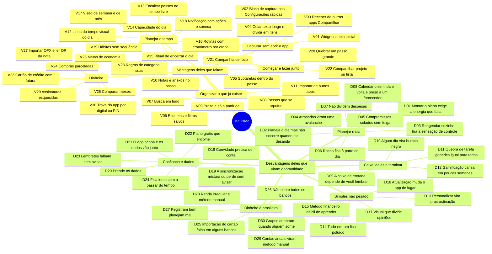

# Concorrentes: o que aproveitar e onde fazer melhor

Pesquisa de outubro de 2026 sobre apps consolidados de tarefas, planejamento do dia e finanças pessoais (Todoist, Things 3, TickTick, Tiimo, Structured, Sunsama, Motion, Reclaim, Amazing Marvin, Goblin Tools, Finch, Habitica, Mobills, Organizze, YNAB, Monarch, Notion e outros). O objetivo é alimentar o [roadmap](ROADMAP.md) só com o que o MeUsMe **ainda não tem**: o que já existe foi descartado (lista no fim), e cada item aparece uma vez.

- **30 vantagens deles** que fazem falta aqui, e **30 desvantagens deles** que viram oportunidade.
- **Cruzamento com o seu perfil** (31/10/2026): para cada item, o que ele ganha e o que custa para você como usuário e como desenvolvedor, com uma onda própria. A leitura do perfil, os sinais citados (U1 a U11, D1 a D10) e a revisão das funções que o app já tem estão em [ROADMAP.md](ROADMAP.md#seu-perfil-e-o-que-ele-muda).
- Mapa mental interativo: abra [mapa-concorrentes.html](mapa-concorrentes.html) no navegador (funciona sem internet, com teclado e leitor de tela; em tela estreita vira lista). Ele alterna entre a leitura pela pesquisa e pelo seu perfil.
- Fora de uma tela larga, o mapa abaixo mostra a mesma coisa no GitHub.

## Como ler

Há duas ondas para cada item. A da **pesquisa** olha só para o que os concorrentes mostram:

- **Onda 1**: Agora: reduz o atrito de capturar ou ajuda a escolher e terminar (o problema central do app).
- **Onda 2**: Depois: melhora algo que já existe.
- **Onda 3**: Depende de servidor, de decisão sua ou de mais pesquisa.

Há 20 itens na onda 1, 30 na onda 2 e 10 na onda 3. A onda **para você** cruza o item com o que você escreveu e com o código de hoje:

- **Onda 1**: Agora: responde a algo que você já escreveu, com esforço pequeno ou médio e sem depender de item posterior. No máximo três itens de Android juntos.
- **Onda 2**: Depois: encaixe alto que depende de itens da onda 1, pede esforço grande, melhora algo que já funciona ou é ganho de longo prazo; ou encaixe médio com ganho claro.
- **Onda 3**: Só se o uso real pedir: sem sinal no seu uso, ou custo alto para o ganho.

Há 11 itens na onda 1, 20 na onda 2 e 29 na onda 3. Itens com **Cuidado** conflitam em parte com os princípios do app (uma coisa de cada vez, sem culpa, dados no aparelho) e só entram adaptados.

Nos itens, **encaixe** é o quanto ele responde ao que você escreveu (alto, médio, baixo); **esforço** é uma estimativa minha para você escrever no ritmo de 1 a 2 horas por dia (P: dias, M: 1 a 2 semanas, G: mais de 2 semanas); **trilha** é a do [guia de estudo](GUIA-DE-ESTUDO.md) que você precisa ter feito antes. Encaixe e esforço são leituras minhas, para discutir, não medidas.

## Por onde começar

### Pela pesquisa

Vinte itens estão na onda 1, o que é muito para "agora". Estes seis vêm primeiro, nesta ordem:

- **D03 · Reagendar sozinho tira a sensação de controle**: Regra de design, custa nada: vale antes de qualquer plano automático.
- **V18 · Notificação com ações e soneca**: Pequeno, e aparece em todo dia de uso.
- **D23 · Lembretes falham sem avisar**: Um lembrete que falha derruba a confiança no app inteiro.
- **V03 · Receber de outros apps (Compartilhar)**: Tira atrito da captura: qualquer texto vira Caixa em dois toques.
- **V08 · Passos que se repetem**: A maior lacuna entre os apps de tarefas: passo que volta sozinho.
- **V20 · Quebrar um passo grande**: Ataca o "não sei por onde começar" e reaproveita o motor local.

Depois deles, **D01 · Montar meu dia** fica mais barato, porque usa passos que se repetem (V08), prazo (V09) e passos quebrados (V20).

### Pelo seu perfil

São 11 itens, nesta ordem. Todos respondem a algo que você já escreveu:

- **D03 · Reagendar sozinho tira a sensação de controle** ✅ feito: Custa só disciplina e vale para tudo o que vier depois: o app propõe e você decide.
- **D08 · Calendário sem ida e volta e preso a um fornecedor** ✅ feito: A sua agenda é compartilhada com colegas e o app só lê a principal.
- **V09 · Prazo e "só a partir de"** ✅ feito: Responde ao "estimar prazos". Entra junto com D04, para atraso não virar culpa.
- **D04 · Atrasados viram uma avalanche** ✅ feito: Vencidos sem vermelho: o par de V09.
- **D25 · Importação do cartão falha em alguns bancos** ✅ feito: A captura pelas notificações do banco é inconsistente: mostra quando uma fonte de gastos parou, sem você ter de perceber sozinho.
- **V03 · Receber de outros apps (Compartilhar)** ✅ feito: Captura sem digitar vinda de qualquer app.
- **V02 · Bloco de captura nas Configurações rápidas** ✅ feito: Captura em dois toques de qualquer tela do celular; faça depois de V03.
- **V27 · Importar OFX e ler QR da nota** ✅ feito: OFX como plano B que não depende de notificação nem de Open Finance.
- **V20 · Quebrar um passo grande** ✅ feito: Versão guiada do "quebrar": ataca o ponto de perder a energia perto do fim.
- **D14 · Tudo-em-um fica poluído** ✅ feito: Módulos que se desligam: segura a tensão entre tudo em um lugar e se perder.
- **D13 · Personalizar vira procrastinação** ✅ feito: Perfis prontos na introdução, em cima de D14.

Os de Android (V02 e V03) pedem a trilha 10 antes e D08 pede a trilha 9; V09, V20, V27, D04, D13, D14 e D25 são só TypeScript e React, e D03 nem isso: é uma regra. Nenhum exige Rust.

## Mapa mental

## Cruzamento com o seu perfil

Ganho e custo de cada item **para você**. Resumo: 20 itens de encaixe alto, 23 médio e 17 baixo. Por onda, a pesquisa dá 20 / 30 / 10 e o seu perfil dá 11 / 20 / 29.

- **Mudam de onda:** 31 itens. Sobem: V27, D08. Descem: V01, V05, V06, V07, V08, V10, V11, V12, V15, V16, V17, V18, V23, V24, V25, V26, V29, V30, D01, D02, D05, D06, D10, D11, D15, D23, D27, D28, D29.
- **Encaixe alto fora da onda 1:** V01, V12, V13, V14, V23, D01, D02, D20, D26. Dependem de outros itens (V13, V14, D01, D02), pedem esforço grande (V01, V23, D01, D26), melhoram algo que já funciona (V12) ou são de longo prazo (D20).
- **Sem sinal no seu uso:** os 17 de encaixe baixo (V05, V06, V10, V11, V16, V19, V21, V22, V29, D06, D07, D10, D11, D12, D17, D18, D30) ficam na onda 3. Podem valer para o público na fase 3 do roadmap; para você, só se o uso real pedir.

### 30 vantagens deles

#### Capturar sem abrir o app

| # | Item | Encaixe | Ganho para você | Custo ou risco para você | Esforço · infraestrutura · trilha | Onda (pesquisa → você) |
|---|---|---|---|---|---|---|
| V01 | **Widget na tela inicial** | **alto** | Próximo passo e captura sem abrir o app: tira o toque que mais pesa (U5). | Código nativo de Android (Java, trilha 10); precisa de teste no emulador e de atualização do widget. | G · Android nativo · trilha 10 (Android) | 1 → 2 |
| V02 | **Bloco de captura nas Configurações rápidas** ✅ feito | **alto** | Captura em dois toques de qualquer tela do celular, sem ocupar a tela inicial (U5). | Serviço nativo do Android (Java, trilha 10), mais código para testar; faça depois de V03, que ensina o caminho do Android. | M · Android nativo · trilha 10 (Android) | 1 → 1 |
| V03 | **Receber de outros apps (Compartilhar)** ✅ feito | **alto** | Qualquer texto, link ou print vira Caixa em dois toques, sem digitar (U5); você já manda 77 imagens e 55 arquivos nos chats (D9). | Filtro de compartilhamento no Android e plugin do Capacitor (trilha 10); na web o share_target só funciona com o app instalado. | M · Android nativo · trilha 10 (Android) | 1 → 1 |
| V04 | **Colar texto longo e dividir em itens** | médio | Cola uma conversa ou ata e o motor separa em capturas (U5), reaproveitando as regras que já existem. | Texto longo gera muita captura errada: precisa de pré-visualização e Desfazer para não encher a Caixa. | P · só no aparelho · trilha 5 (Estado e dados locais) | 2 → 2 |

#### Organizar o que já existe

| # | Item | Encaixe | Ganho para você | Custo ou risco para você | Esforço · infraestrutura · trilha | Onda (pesquisa → você) |
|---|---|---|---|---|---|---|
| V05 | **Subtarefas dentro do passo** | baixo | Lista pequena dentro de um passo. | O projeto já é a lista de passos; um terceiro nível duplica o conceito e complica a mesclagem da sincronização (dívida 2). | M · só no aparelho · trilha 5 (Estado e dados locais) | 2 → 3 |
| V06 | **Etiquetas e filtros salvos** | baixo | Escolher o que fazer por lugar ou por tempo disponível. | Etiqueta exige manutenção, o que fez você largar outras ferramentas (U6). | M · só no aparelho · trilha 4 (React) | 2 → 3 |
| V07 | **Busca em tudo** ✅ feito | médio | Com tudo em um lugar (D5), achar algo vira necessário; é código local e simples de explicar (D2). | Sua memória é boa (U2), então pesa menos hoje; precisa varrer passos, ideias, gastos e eventos sem travar o localStorage. | P · só no aparelho · trilha 5 (Estado e dados locais) | 1 → 2 |
| V08 | **Passos que se repetem** ✅ feito | médio | A rotina volta sozinha: menos coisa para recriar (U6). | Mexe no tipo Passo e na sincronização; precisa não encher o Agora antes da hora. | M · só no aparelho · trilha 5 (Estado e dados locais) | 1 → 2 |
| V09 | **Prazo e "só a partir de"** ✅ feito | **alto** | Responde ao "estimar prazos" (U1): o prazo pesa na escolha do Agora e o "só a partir de" esconde o que ainda não é hora. | Campo novo no Passo (sincronização e backup); sem D04 vira pilha vermelha, que o app evita. | M · só no aparelho · trilha 5 (Estado e dados locais) | 1 → 1 |
| V10 | **Notas e anexos no passo** | baixo | Guardar contexto junto do passo. Você anexa imagem e arquivo ao Claude com frequência (D9), mas é para depurar: não prova que queira anexar a passos. | Foto e arquivo estouram o localStorage (cerca de 5 MB, dívida 1): só depois do IndexedDB da fase 2. | G · só no aparelho · trilha 5 (Estado e dados locais) | 2 → 3 |
| V11 | **Importar de outros apps** | baixo | Trazer o que ficou em outros apps. | Cada formato é um leitor a manter; para você, que largou esses apps, o ganho é pequeno. Vale mais no lançamento público. | M · só no aparelho · trilha 5 (Estado e dados locais) | 2 → 3 |

#### Planejar o tempo

| # | Item | Encaixe | Ganho para você | Custo ou risco para você | Esforço · infraestrutura · trilha | Onda (pesquisa → você) |
|---|---|---|---|---|---|---|
| V12 | **Linha do tempo visual do dia** | **alto** | Ver o dia inteiro de relance, como você pediu da agenda (U8). | Gráfico é mais difícil de tornar acessível (teclado e leitor de tela); a lista com folgas já existe. | M · só no aparelho · trilha 4 (React) | 1 → 2 |
| V13 | **Encaixar passos no tempo livre** | **alto** | O app propõe quando fazer (U4), em vez de você decidir sozinho (U1). | Só é bom com palpites de tempo, que são opcionais; nunca mover sozinho (D03). | M · só no aparelho · trilha 5 (Estado e dados locais) | 2 → 2 |
| V14 | **Capacidade do dia** | **alto** | Avisa que "não cabe hoje" usando o seu palpite × real (U1, U9). | Depende de palpites e de prazo (V09); sem dados parece chute. | P · só no aparelho · trilha 5 (Estado e dados locais) | 2 → 2 |
| V15 | **Ritual de encerrar o dia** | médio | Fecha o dia sem culpa e leva o que sobrou para amanhã (U2). | Já existe o check-in das 21h; é quase a mesma coisa e pode virar mais um aviso (U6). | P · só no aparelho · trilha 4 (React) | 2 → 3 |
| V16 | **Rotinas com cronômetro por etapa** | baixo | Manhã e noite em etapas com tempo. | Sem sinal no seu uso, e se sobrepõe aos passos que se repetem (V08). | M · só no aparelho · trilha 4 (React) | 2 → 3 |
| V17 | **Visão de semana e de mês** | médio | Visão do mês dos compromissos. | A semana já aparece em telas largas; o mês ocupa espaço e ajuda pouco a escolher o próximo passo. | M · só no aparelho · trilha 4 (React) | 2 → 3 |
| V18 | **Notificação com ações e soneca** | médio | "Feito" e "daqui a 10 min" na própria notificação: resolve sem abrir o app (U5) e dá ao lembrete um caminho de volta. | Ações exigem código nativo no Android; no navegador e no Windows é preciso conferir o que é possível. Não vi queixa sua sobre lembretes: vale depois de testá-los no celular real. | M · Android nativo · trilha 10 (Android) | 1 → 2 |
| V19 | **Hábitos sem sequência** | baixo | Contagem semanal sem sequência. | Sem sinal no seu uso, e a pesquisa do app deixou gamificação de fora de propósito. | M · só no aparelho · trilha 5 (Estado e dados locais) | 3 → 3 |

#### Começar e fazer junto

| # | Item | Encaixe | Ganho para você | Custo ou risco para você | Esforço · infraestrutura · trilha | Onda (pesquisa → você) |
|---|---|---|---|---|---|---|
| V20 | **Quebrar um passo grande** ✅ feito | **alto** | Ataca o ponto que você descreveu: perto do fim sobram só ideias vagas (U2). | Sem nuvem, o motor não quebra qualquer tarefa: comece guiado ("qual é o primeiro movimento de 2 minutos?") e deixe os passos novos com energia baixa (queixa de 6/10). | M · só no aparelho · trilha 5 (Estado e dados locais) | 1 → 1 |
| V21 | **Companhia de foco** | baixo | Foco acompanhado, sem estranhos. | Exige servidor e convite (D1); a pesquisa do app deixou body doubling de fora por evidência fraca. | G · precisa de servidor · trilha 8 (Sincronização) | 3 → 3 |
| V22 | **Compartilhar projeto ou lista** | baixo | Lista de compras ou projeto com outra pessoa; a sincronização por item já existe. | Convite, permissões e quem vê o quê: Postgres e segurança (trilha 7), e o seu servidor ainda não foi testado de verdade. | G · precisa de servidor · trilha 7 (Supabase) | 3 → 3 |

#### Dinheiro

| # | Item | Encaixe | Ganho para você | Custo ou risco para você | Esforço · infraestrutura · trilha | Onda (pesquisa → você) |
|---|---|---|---|---|---|---|
| V23 | **Cartão de crédito com fatura** | **alto** | Com cinco bancos e carteiras (U10), compra no cartão e pagamento da fatura não podem contar duas vezes no "livre por dia". | Modelo novo (fechamento, vencimento, limite) e conciliação com as notificações. Confirme no uso real (fase 1) se a contagem dupla acontece antes de construir. | G · só no aparelho · trilha 5 (Estado e dados locais) | 1 → 2 |
| V24 | **Compras parceladas** | médio | "12x de 89" aparece como compromisso futuro. | Só ajuda de verdade com o cartão (V23) e depende de a notificação trazer as parcelas: confira nos textos reais (fase 1). | M · só no aparelho · trilha 5 (Estado e dados locais) | 1 → 3 |
| V25 | **Metas de economia** | médio | Reaproveita a "linha de chegada" dos projetos para dinheiro. | Mais uma tela em Finanças, sem sinal de que você precise (U6). | P · só no aparelho · trilha 4 (React) | 2 → 3 |
| V26 | **Comparar meses** | médio | Consultas por mês combinam com a sua experiência em bancos locais (D2) e dão uso aos dados que você junta. | Só vale com meses de dados; hoje são barras por categoria. | M · só no aparelho · trilha 5 (Estado e dados locais) | 2 → 3 |
| V27 | **Importar OFX e ler QR da nota** ✅ feito | **alto** | OFX é o extrato padrão dos bancos: caminho que não depende de notificação nem de Open Finance (U7, D1) e serve de plano B se a Play recusar a leitura de notificações (D3). | Cada banco escreve o OFX de um jeito: leitor com testes de arquivos reais. A parte do QR da nota (câmera) eu deixaria de fora. | M · só no aparelho · trilha 5 (Estado e dados locais) | 2 → 1 |
| V28 | **Regras de categoria suas** | médio | Regra "se contém Uber, é Transporte": declarativa, que você consegue ler e explicar, como no motor (D2, D7). | Mais uma lista a manter; o motor já aprende com o que você organiza, então evite duas formas de ensinar o mesmo app. | P · só no aparelho · trilha 5 (Estado e dados locais) | 2 → 2 |
| V29 | **Assinaturas esquecidas** | baixo | Lista o que se repete todo mês e pergunta "ainda usa?". | Sem sinal no seu uso; depende de lançamentos limpos (D25 e D26 primeiro). | P · só no aparelho · trilha 5 (Estado e dados locais) | 2 → 3 |
| V30 | **Trava do app por digital ou PIN** | médio | Para um app de dinheiro que vai à loja, a trava dá confiança a quem usa (D3). | Biometria muda por plataforma (Android, Windows Hello); para uso só seu, o ganho é pequeno. | M · Android nativo · trilha 10 (Android) | 2 → 3 |

### 30 desvantagens deles

#### Planejar o dia

| # | Item | Encaixe | Ganho para você | Custo ou risco para você | Esforço · infraestrutura · trilha | Onda (pesquisa → você) |
|---|---|---|---|---|---|---|
| D01 | **Montar o plano exige a energia que falta** | **alto** | É o centro do que você pediu: o app sugere 3 a 5 passos e horários a partir da energia, da agenda e dos palpites (U1, U4). | Só fica bom depois de prazo (V09), repetição (V08) e quebra (V20); antes disso sugere com pouco dado. | G · só no aparelho · trilha 5 (Estado e dados locais) | 1 → 2 |
| D02 | **Planeja o dia, mas não socorre quando ele desanda** | **alto** | Quando o dia desanda, reencaixa o que sobrou sem chamar nada de atraso (U2). | Usa a mesma lógica de D01: construir os dois juntos evita duplicar. | M · só no aparelho · trilha 5 (Estado e dados locais) | 1 → 2 |
| D03 | **Reagendar sozinho tira a sensação de controle** ✅ feito | **alto** | Regra de projeto, sem código novo: o app propõe, diz o motivo e você decide (U1, U4). | Nenhum, além da disciplina: vale para tudo o que vier depois (D01, D02, V13). | P · só no aparelho · trilha 5 (Estado e dados locais) | 1 → 1 |
| D04 | **Atrasados viram uma avalanche** ✅ feito | **alto** | Vencidos viram "para reagendar" em lote, sem pilha vermelha (U2). | Só existe quando houver prazo nos passos (V09); hoje só os lembretes vencem. | M · só no aparelho · trilha 5 (Estado e dados locais) | 1 → 1 |
| D05 | **Compromissos colados, sem folga** | médio | Com agenda compartilhada (U8), compromissos colados são comuns; o aviso de folga ajuda. | A lista do dia já mostra os intervalos livres; é um ajuste a mais (U6). | P · só no aparelho · trilha 4 (React) | 2 → 3 |
| D06 | **Rotina fica à parte do dia** | baixo | Rotina dentro da linha do dia. | Depende de V12 e V16, ambos sem sinal forte no seu uso. | M · só no aparelho · trilha 4 (React) | 2 → 3 |
| D07 | **Não dividem despesas** | baixo | Quem deve a quem numa casa. | Pede compartilhamento (V22) e servidor; não apareceu nas suas conversas. | G · precisa de servidor · trilha 7 (Supabase) | 3 → 3 |
| D08 | **Calendário sem ida e volta e preso a um fornecedor** ✅ feito | **alto** | Sua agenda real é a compartilhada com colegas e o app lê só a principal: ler as agendas que você escolher (ou um .ics) resolve o que você pediu em 8/9. | Mesma verificação do Google (meses, D1) ou .ics, que só existe para agendas que você administra: confira a permissão na própria agenda antes de decidir. | M · depende do Google · trilha 9 (Integrações e OAuth) | 3 → 1 |

#### Caixa, ideias e terminar

| # | Item | Encaixe | Ganho para você | Custo ou risco para você | Esforço · infraestrutura · trilha | Onda (pesquisa → você) |
|---|---|---|---|---|---|---|
| D09 | **A caixa de entrada depende de você lembrar** | médio | O que dorme há 30 dias volta com uma pergunta: não depende da sua memória (U6). | É mais um aviso; precisa de um jeito simples de responder (apagar, virar passo, adiar). | P · só no aparelho · trilha 5 (Estado e dados locais) | 2 → 2 |
| D10 | **"Algum dia" vira buraco negro** | baixo | Ideias que não se acumulam para sempre. | Perguntar a cada 90 dias é outro aviso: junte com D09 numa revisão só. | P · só no aparelho · trilha 5 (Estado e dados locais) | 2 → 3 |
| D11 | **Quebra de tarefa genérica, igual para todos** | baixo | Quebra no seu tamanho de passo. | Depende de V20 e de muito histórico; é um modelo a mais para você explicar (D2). | G · só no aparelho · trilha 5 (Estado e dados locais) | 2 → 3 |
| D12 | **Gamificação cansa em poucas semanas** | baixo | Marca a reta final concluída (U2), sem pontos. | Corre o risco de virar gamificação, que o app evita de propósito. | P · só no aparelho · trilha 4 (React) | 3 → 3 |

#### Simples, não pesado

| # | Item | Encaixe | Ganho para você | Custo ou risco para você | Esforço · infraestrutura · trilha | Onda (pesquisa → você) |
|---|---|---|---|---|---|---|
| D13 | **Personalizar vira procrastinação** ✅ feito | **alto** | Em vez de montar o sistema (o que você largou em outras ferramentas, U6), escolhe um perfil pronto na introdução. | Depende de D14; cada perfil é um caminho a mais para testar. | P · só no aparelho · trilha 4 (React) | 1 → 1 |
| D14 | **Tudo-em-um fica poluído** ✅ feito | **alto** | Resolve a tensão entre "tudo em um lugar" e "me perco em ferramenta pesada" (D5): liga só o que usa. | Mexe no menu e nas rotas; os dados continuam gravados; é preciso testar cada combinação ligada ou desligada. | M · só no aparelho · trilha 4 (React) | 1 → 1 |
| D15 | **Método financeiro difícil de aprender** | médio | Começa só com o "livre por dia". | Para você, que já usa tudo, ajuda pouco; é mais para quem chega novo. | M · só no aparelho · trilha 4 (React) | 2 → 3 |
| D16 | **Atualização muda o app de lugar** | médio | Você publicou quatro versões entre 27 e 30/10: uma tela "O que mudou" explica cada uma. | Texto a escrever a cada versão; precisa ser curto. | P · só no aparelho · trilha 4 (React) | 2 → 2 |
| D17 | **Visual que divide opiniões** | baixo | Compacto ou confortável. | Mais um ajuste; já existem tema, tamanho de texto e botões maiores. | P · só no aparelho · trilha 3 (HTML e CSS) | 3 → 3 |

#### Confiança e dados

| # | Item | Encaixe | Ganho para você | Custo ou risco para você | Esforço · infraestrutura · trilha | Onda (pesquisa → você) |
|---|---|---|---|---|---|---|
| D18 | **Convidado precisa de conta** | baixo | Compartilhar por link. | Depende de V22 e da segurança do servidor. | G · precisa de servidor · trilha 7 (Supabase) | 3 → 3 |
| D19 | **A sincronização mistura ou perde sem avisar** | médio | Perder dado é o risco número 1 do roadmap; ver o que mudou entre aparelhos dá confiança (D4). | Mesclar campo a campo é a dívida 2; só vale depois de a fase 1 mostrar conflitos reais. | G · precisa de servidor · trilha 8 (Sincronização) | 2 → 2 |
| D20 | **Prende os dados** | **alto** | Seus dados em CSV, Markdown e .ics: coerente com querer controle (D2), com o direito de levar os dados (LGPD, fase 4) e com o seu hábito de exportar CSV e conferir no Excel (D9). | Cada formato precisa ser documentado e testado na volta (importar o que exportou). | P · só no aparelho · trilha 5 (Estado e dados locais) | 2 → 2 |
| D21 | **O app acaba e os dados vão junto** | médio | Hoje o backup é manual e o servidor ainda não foi testado: uma cópia automática protege você, e você já exige backup antes de operações destrutivas (D8). | No Android depende de onde gravar (permissão de arquivos); no Windows é uma pasta. | M · só no aparelho · trilha 10 (Android) | 2 → 2 |
| D22 | **Plano grátis que encolhe** | médio | Você quer "valor comercial" sem infraestrutura gigante (28/10): decidir cedo o que é gratuito evita surpresa de custo. | É decisão de negócio, não de código; adie até a fase 3, mas não até depois do lançamento. | P · decisão sua · trilha 12 (Qualidade e publicação) | 3 → 3 |
| D23 | **Lembretes falham sem avisar** | médio | Lembrete que falha é invisível: testa permissão, bateria e alarme exato, dispara um teste e ensina a consertar; também ajuda a explicar as permissões à loja (D3). | Cada fabricante de Android trata a bateria de um jeito: precisa de aparelho real além do emulador. Não vi queixa sua sobre lembretes: suba este item se algum falhar na fase 1. | M · Android nativo · trilha 10 (Android) | 1 → 2 |
| D24 | **Fica lento com o passar do tempo** | médio | Teste automático: abrir em menos de 1 segundo com 5 anos de dados, o seu jeito de conferir (D4). | Só faz sentido depois do IndexedDB (fase 2); deixa a integração contínua mais lenta. | M · só no aparelho · trilha 12 (Qualidade e publicação) | 2 → 2 |

#### Dinheiro à brasileira

| # | Item | Encaixe | Ganho para você | Custo ou risco para você | Esforço · infraestrutura · trilha | Onda (pesquisa → você) |
|---|---|---|---|---|---|---|
| D25 | **Importação do cartão falha em alguns bancos** ✅ feito | **alto** | Mostra quando cada fonte (notificações, Meu Pluggy, CSV) trouxe dado pela última vez: você vê quando o banco parou de avisar (U7). | Os dados já existem; a dificuldade é decidir quando "parou" é normal (uma semana sem gastos). | M · só no aparelho · trilha 5 (Estado e dados locais) | 1 → 1 |
| D26 | **Não cobre todos os bancos** | **alto** | Com cinco bancos e formatos que mudam (U10), você marca valor e descrição num exemplo e o app cria o padrão, uma regra legível (D7), sem manter um leitor por banco (D1). | Interface para marcar trechos, geração do padrão e testes: o item mais difícil desta lista (D2). | G · só no aparelho · trilha 5 (Estado e dados locais) | 2 → 2 |
| D27 | **Registram bem, planejam mal** ✅ feito | médio | Mostra o efeito no "livre por dia" antes de decidir. | A lista de espera já segura a compra; o ganho é o cálculo, que depende de saldo confiável (D25). | M · só no aparelho · trilha 5 (Estado e dados locais) | 1 → 3 |
| D28 | **Renda irregular é método manual** | médio | Se a sua renda varia com vendas (você citou vendas como exemplo em 28/10), o "livre por dia" sobre o que já entrou é mais honesto. | Não vi sinal de que seja o seu caso; só vale se for. | M · só no aparelho · trilha 5 (Estado e dados locais) | 2 → 3 |
| D29 | **Contas anuais viram método manual** | médio | IPVA, IPTU e seguro divididos por 12 deixam de ser surpresa. | Sem sinal no seu uso; as contas fixas já avisam o vencimento. | M · só no aparelho · trilha 5 (Estado e dados locais) | 2 → 3 |
| D30 | **Grupos quebram quando alguém some** | baixo | Prestação de contas em dupla. | Depende de V21 e de servidor; sem sinal no seu uso. | G · precisa de servidor · trilha 8 (Sincronização) | 3 → 3 |

## Captura por assistente de voz (Gemini e Siri)

Pesquisa de 01/11/2026, a partir de V01 a V03 e do sinal U5 (você já dita pedidos por áudio). Na Siri a integração direta já é possível para qualquer app, mas exige app nativo de iPhone; no Gemini ela existe, mas ainda não está aberta para um app como o MeUsMe.

| # | Item | Situação hoje | O que fazer no MeUsMe | Ganho para você | Custo ou risco | Onda para você | Fonte |
|---|---|---|---|---|---|---|---|
| A1 | **Abrir a captura por voz com "Hey Google, abrir MeUsMe" ✅ feito** | Abrir um app por voz já funciona no Android, com o Assistant ou o Gemini. | Link interno e atalho do app "Capturar por voz" que abrem direto na gravação que já salva a nota. | Você já dita pedidos por áudio (U5); são dois passos, mas sem digitar nada. | Pequeno: a maior parte é TypeScript; o atalho do app é configuração nativa do Android (trilha 10). | 1 | [Fórum Google AI: atalhos de app e o Gemini](https://discuss.ai.google.dev/t/how-to-invoke-custom-dynamic-shortcuts-and-app-functions-with-gemini/103215) |
| A2 | **Atalho do iPhone que dita e abre o MeUsMe** | O app Atalhos do iPhone dita um texto e abre um link; não precisa de código Swift. | O app entende um link com o texto ditado e grava na Caixa. Serve antes da integração completa com a Siri. | Captura por voz no iPhone sem esperar a fase 8 inteira. | Depende de haver app ou PWA instalado no iPhone; o usuário monta o atalho uma vez. | 3 | [Matthew Cassinelli: atalhos do Gemini no iPhone via App Intents](https://matthewcassinelli.com/replace-siri-gemini-action-button-shortcuts) |
| A3 | **Siri: "Anotar no MeUsMe" (App Intents)** | Possível hoje para qualquer app: App Shortcuts (iOS 16 em diante) ficam na Siri, no Spotlight e no Atalhos sem configuração do usuário. No iOS 27 os App Schemas levam isso para a Apple Intelligence. | App Shortcut "Anotar no MeUsMe" que pergunta o texto e grava na Caixa; o resto do app continua em React (Capacitor). | Captura de uma vez só, pela voz, no iPhone. | Código Swift, Mac com Xcode e conta Apple Developer (fase 8). Não confirmei na documentação: a frase precisa ter o nome do app, há limite de cerca de 10 atalhos e a Siri pergunta o texto em seguida. | 3 | [Apple WWDC24: Bring your app to Siri](https://developer.apple.com/videos/play/wwdc2024/10133/); [Apple WWDC26: Build intelligent Siri experiences with App Schemas](https://developer.apple.com/videos/play/wwdc2026/240/); [Apple: documentação de App Shortcuts](https://developer.apple.com/documentation/appintents/app-shortcuts) |
| A4 | **Gemini: "anota X no MeUsMe" (AppFunctions)** | As App Actions do Assistant não passaram para o Gemini (relato de desenvolvedor). O caminho novo, AppFunctions (Android 16 em diante), roda no aparelho, mas em fevereiro de 2026 estava restrito a um pequeno grupo de desenvolvedores; o Android 17 deve ampliar. Há também a Connected Apps Platform (preview, outubro de 2026), que exige servidor MCP. | Esperar o AppFunctions abrir para todos e expor "capturar na Caixa" como função local. Não usar a Connected Apps Platform, que pede servidor (D1). | Captura de uma vez só pelo Gemini, sem servidor, no mesmo motor de regras. | Hoje não está disponível para o MeUsMe; reavaliar quando o Android 17 sair. | 3 | [9to5Google: AppFunctions deixa o Gemini usar apps Android (fev. 2026)](https://9to5google.com/2026/02/25/android-appfunctions-gemini/); [Android Headlines: Gemini Connected Apps Platform (out. 2026)](https://www.androidheadlines.com/2026/10/google-gemini-connected-apps-platform-preview.html); [Fórum Google AI: atalhos de app e o Gemini](https://discuss.ai.google.dev/t/how-to-invoke-custom-dynamic-shortcuts-and-app-functions-with-gemini/103215) |
| A5 | **Android: MeUsMe como assistente digital padrão (overlay de captura)** | Um app comum pode ser escolhido como "app de assistente digital" nas configurações; o Perplexity faz isso e abre pelo botão liga/desliga ou pelo gesto do canto, sem abrir o app antes. A detecção de palavra de ativação de baixo consumo do sistema é só para apps do fabricante. | Implementar o serviço de assistente do Android para que o gesto abra uma janela de captura por voz por cima do app atual, gravando na Caixa. | É o mais perto de "falar e capturar sem sair do que está fazendo", sem microfone sempre aberto, sem servidor (D1) e sem a permissão de sobrepor apps (D3). | Código nativo (Java, trilha 10). O MeUsMe substitui o Gemini como assistente: quem usa os dois precisa escolher. Não confirmei na documentação do Android para celular os detalhes da API. | 2 | [TechRadar: assistente do Perplexity no Android](https://www.techradar.com/computing/artificial-intelligence/perplexitys-ai-assistant-goes-mobile-on-android); [Android Open Source Project: fluxos de integração de assistentes de voz](https://source.android.com/docs/automotive/voice/voice_interaction_guide/integration_flows) |
| A6 | **Android: "Hey MeUsMe" sempre ligado** | Sem o detector do sistema, o app precisa manter o próprio microfone aberto num serviço em primeiro plano. Esse serviço não pode ser criado com o app em segundo plano, exige a permissão de microfone e deixa notificação fixa e indicador de microfone acesos. A Porcupine (Picovoice) teria encerrado o plano gratuito em 30/06/2026 (relato de usuários); a openWakeWord é aberta (Apache 2.0) e tem versão para Android. | Opcional e desligado por padrão: detector openWakeWord no aparelho que abre o mesmo overlay de A5. | Captura só com a voz, com o celular em qualquer tela. | Bateria, privacidade (microfone sempre aberto) e revisão mais rígida da Play. Modelos treinados com certos conjuntos de dados herdam licença não comercial: confira antes de treinar "Hey MeUsMe". Nomes curtos ou incomuns disparam mais por engano. | 3 | [Android Developers: restrições para iniciar serviço em primeiro plano em segundo plano](https://developer.android.com/develop/background-work/services/fgs/restrictions-bg-start); [Home Assistant Community: fim do plano gratuito da Porcupine em 30/06/2026](https://community.home-assistant.io/t/fyi-picovoice-confirmed-free-tier-accesskeys-will-stop-working-after-june-30-2026/1012744); [openwakeword-android-kt (Apache 2.0)](https://github.com/Re-MENTIA/openwakeword-android-kt); [atlas-voice-training: aviso de licença não comercial em modelos treinados](https://github.com/briankelley/atlas-voice-training) |
| A7 | **Windows: "Hey MeUsMe" abre a janela de captura** | O app já fica na bandeja e já tem a janela de captura por cima de tudo (Win + Ctrl + Alt + Espaço); a palavra de ativação só a abriria. O reconhecimento de voz do navegador não é confiável dentro de WebViews: o Chromium desligou essa API no WebView do Android e o suporte no Edge é irregular. | Opcional e desligado por padrão: detector openWakeWord no lado Rust, e um motor de transcrição próprio em vez da API de voz do WebView2. | Você passa o expediente no PC (D6): capturar por voz sem trocar de janela serve no trabalho. | Rust (trilha 11), microfone aberto com o ícone do Windows aceso, e escolher e testar um motor de transcrição local. Não confirmei o comportamento da API de voz no WebView2 especificamente. | 3 | [Chromium: API de voz desligada no WebView](https://issues.chromium.org/41172064); [Microsoft Q&A: webkitSpeechRecognition no Edge](https://learn.microsoft.com/en-us/answers/a/2054895); [openwakeword-android-kt (Apache 2.0)](https://github.com/Re-MENTIA/openwakeword-android-kt) |
| A8 | **iPhone: sem palavra de ativação; Botão de Ação no lugar** | O iOS não deixa app de terceiros ligar o microfone em segundo plano para escutar uma palavra, e as regras da App Store limitam o segundo plano a usos como áudio, VoIP e localização; também não há sobreposição a outros apps. | Ligar o Botão de Ação (iPhone 15 Pro em diante) ou o "toque nas costas" ao App Shortcut de A3. | Um gesto físico no lugar da voz, sem abrir o app. | Depende de A3 (Swift, fase 8). Não achei texto da Apple sobre palavra de ativação; as fontes são de fórum e de fornecedores. | 3 | [Apple Developer Forums: palavra de ativação no iOS](https://developer.apple.com/forums/thread/826681); [Regras da App Store: serviços em segundo plano só para o uso previsto](https://conductatlas.com/platform/apple/apple-app-store-review-guidelines/provision/CA-P-018863/multitasking-background-services-limited-to-intended-purposes/); [Willow: microfone em segundo plano no iOS](https://help.willowvoice.com/en/articles/12855752-why-am-i-taken-back-to-the-willow-ios-app-before-i-can-dictate) |

As fontes sobre o Gemini são de imprensa e de fórum (não achei documento oficial sobre o fim das App Actions); sobre a Siri, as páginas da Apple não confirmaram os limites dos App Shortcuts. Reavalie A4 quando o Android 17 sair. De A5 a A8 (um "Hey MeUsMe" próprio com overlay), a regra do microfone em primeiro plano vem da documentação do Android; o fim do plano gratuito da Porcupine, o comportamento da voz no WebView2 e as regras do iPhone vêm de relatos de usuários, fórum e fornecedores.

## 30 vantagens deles que o MeUsMe ainda não tem

### Capturar sem abrir o app

| # | Item | Quem | O que se sabe | O que fazer no MeUsMe | Onda | Fonte |
|---|---|---|---|---|---|---|
| V01 | **Widget na tela inicial** | Structured, Things, Todoist | Widgets estão entre os recursos do Structured, e usuários do Goblin Tools pedem um. | Widget Android com o próximo passo e um botão de captura. No Windows o atalho global já cobre. | 1 | [Super Productivity: comparativo de apps de tarefas (2026)](https://super-productivity.com/blog/best-adhd-task-management-apps-2026/); [Saner.AI: análise do Goblin Tools](https://blog.saner.ai/goblin-tools-review/) |
| V02 | **Bloco de captura nas Configurações rápidas** | Todoist (Android) | O Todoist tem um bloco "Adicionar tarefa" nas Configurações rápidas do Android, que cria a tarefa sem abrir o app. No MeUsMe não há. | Bloco nas Configurações rápidas e, opcional, uma notificação fixa com campo de texto, os dois gravando na Caixa. | 1 | [Todoist: bloco "Adicionar tarefa" nas Configurações rápidas do Android](https://todoist.com/help/articles/add-an-add-task-quick-setting-tile-on-android) |
| V03 | **Receber de outros apps (Compartilhar)** | Things, Todoist | O Things cria tarefa pelo Quick Entry de qualquer site e por e-mail encaminhado; o Todoist também aceita e-mail. | Alvo de compartilhamento no Android (e share_target na PWA) que grava na Caixa. Depois: "Ok Google, anotar no MeUsMe". | 1 | [Morgen: Todoist × Things 3](https://www.morgen.so/blog-posts/todoist-vs-things-3); [The Digital Project Manager: Things 3](https://thedigitalprojectmanager.com/tools/things-3-review/) |
| V04 | **Colar texto longo e dividir em itens** | Goblin Tools (Compiler) | O Compiler transforma um despejo de notas numa lista de ações. | Colar um parágrafo e o motor separa em capturas, uma por linha ou frase, com Desfazer. Roda no aparelho. | 2 | [Saner.AI: análise do Goblin Tools](https://blog.saner.ai/goblin-tools-review/) |

### Organizar o que já existe

| # | Item | Quem | O que se sabe | O que fazer no MeUsMe | Onda | Fonte |
|---|---|---|---|---|---|---|
| V05 | **Subtarefas dentro do passo** | Things, Todoist, Structured | O Things tem checklists dentro da tarefa, o Todoist tem subtarefas aninhadas e o Structured também. | Uma lista simples dentro do passo, só um nível, para não virar árvore. O passo conclui quando tudo está marcado. **Cuidado:** Só um nível: árvore profunda contraria "uma coisa de cada vez". | 2 | [Morgen: Todoist × Things 3](https://www.morgen.so/blog-posts/todoist-vs-things-3); [Super Productivity: comparativo de apps de tarefas (2026)](https://super-productivity.com/blog/best-adhd-task-management-apps-2026/) |
| V06 | **Etiquetas e filtros salvos** | Todoist, Things, TickTick | Etiquetas, filtros e prioridades p1 a p4 no Todoist; tags no Things. | "@rua", "@celular", "10 min": o filtro salvo vira um atalho para escolher o que fazer onde você está. | 2 | [Morgen: Todoist × Things 3](https://www.morgen.so/blog-posts/todoist-vs-things-3) |
| V07 | **Busca em tudo** | Things, Todoist | O Quick Find do Things junta navegação e busca (nomes primeiro, depois notas, checklists e Logbook); a busca do Todoist cobre tarefas, projetos, filtros, etiquetas e comentários. No MeUsMe só existe a sugestão de passos ao digitar. | Uma busca (Ctrl+K) que olha passos, ideias, capturas, lançamentos e compromissos. | 1 | [MacStories: Quick Find do Things](https://www.macstories.net/reviews/things-quick-find-feature-upgraded-across-iphone-ipad-and-mac/); [Todoist: introdução aos filtros e à busca](https://todoist.com/en/help/articles/introduction-to-filters) |
| V08 | **Passos que se repetem** | Todoist, TickTick, Things | Recorrência é padrão no Todoist; no Structured é recurso pago. O MeUsMe repete lembretes e compromissos, mas não passos. | "Regar as plantas" volta para a fila toda semana, sem ocupar a tela Agora antes da hora. | 1 | [Morgen: Todoist × Things 3](https://www.morgen.so/blog-posts/todoist-vs-things-3); [Super Productivity: comparativo de apps de tarefas (2026)](https://super-productivity.com/blog/best-adhd-task-management-apps-2026/) |
| V09 | **Prazo e "só a partir de"** | Things, Todoist | O Things separa data de início e prazo final; o Todoist tem data de vencimento. | Prazo opcional que pesa na escolha de Agora, e data de início que esconde o passo até lá. Junto com D04, para atraso não virar culpa. | 1 | [Morgen: Todoist × Things 3](https://www.morgen.so/blog-posts/todoist-vs-things-3); [The Digital Project Manager: Things 3](https://thedigitalprojectmanager.com/tools/things-3-review/) |
| V10 | **Notas e anexos no passo** | Things, Todoist | Notas em Markdown no Things; o Todoist guarda anexos de e-mails encaminhados. | Nota curta, link e foto guardados no aparelho, incluídos no backup. | 2 | [Morgen: Todoist × Things 3](https://www.morgen.so/blog-posts/todoist-vs-things-3) |
| V11 | **Importar de outros apps** | Todoist, TickTick | Quem migra de app sofre com formato: um usuário contou que perdeu toda a formatação ao importar do Evernote. | Importar o CSV ou JSON do Todoist, Things, TickTick e Google Tarefas para projetos e passos. | 2 | [Unstar: o que reclamam os usuários de apps de produtividade](https://unstar.app/blog/productivity-app-reviews-what-power-users-complain-about-2026) |

### Planejar o tempo

| # | Item | Quem | O que se sabe | O que fazer no MeUsMe | Onda | Fonte |
|---|---|---|---|---|---|---|
| V12 | **Linha do tempo visual do dia** | Tiimo, Structured | O dia aparece como blocos de cor e ícone, fácil de varrer com o olhar. | Uma faixa do dia com compromissos, passos reservados e tempo livre. Hoje o Agora mostra só o próximo. | 1 | [Inflow: alternativas ao Tiimo](https://www.getinflow.io/post/best-alternatives-tiimo-adhd); [Super Productivity: comparativo de apps de tarefas (2026)](https://super-productivity.com/blog/best-adhd-task-management-apps-2026/) |
| V13 | **Encaixar passos no tempo livre** | Sunsama, Motion, Structured | Passos viram blocos no calendário. O Motion faz isso sozinho; o Sunsama deixa você decidir. | Ao tocar num passo, o app propõe horários livres. Hoje o horário é escolhido por você. **Cuidado:** Só propor, nunca mover sozinho (ver D03). | 2 | [Dupple: Motion × Sunsama](https://dupple.com/compare/motion-vs-sunsama); [Super Productivity: comparativo de apps de tarefas (2026)](https://super-productivity.com/blog/best-adhd-task-management-apps-2026/) |
| V14 | **Capacidade do dia** | Sunsama | O Sunsama avisa quando o dia está sobrecarregado e compara o planejado com o tempo livre do calendário. | Aviso gentil quando a soma dos palpites passa do tempo livre: "isto não cabe hoje, o que fica para amanhã?". | 2 | [Super Productivity: comparativo de apps de tarefas (2026)](https://super-productivity.com/blog/best-adhd-task-management-apps-2026/) |
| V15 | **Ritual de encerrar o dia** | Sunsama | O fluxo de encerramento do Sunsama inclui uma revisão do que foi feito. | Um minuto no fim do dia: o que foi feito e o que passa para amanhã, sem marcar nada como atrasado. Aproveita o check-in. | 2 | [Super Productivity: comparativo de apps de tarefas (2026)](https://super-productivity.com/blog/best-adhd-task-management-apps-2026/); [Dupple: Motion × Sunsama](https://dupple.com/compare/motion-vs-sunsama) |
| V16 | **Rotinas com cronômetro por etapa** | Routinery, Tiimo | O Routinery conduz a rotina etapa por etapa com contagem regressiva; o Tiimo avisa a transição entre atividades. | Rotina de manhã ou de noite como sequência de etapas com tempo, e aviso antes do próximo compromisso. | 2 | [Inflow: alternativas ao Tiimo](https://www.getinflow.io/post/best-alternatives-tiimo-adhd) |
| V17 | **Visão de semana e de mês** | TickTick, Sunsama, Todoist | TickTick e Sunsama trazem o calendário embutido; no Todoist a visão de calendário é do plano pago. | Semana e mês na Agenda, com os passos reservados. Hoje a Agenda lista dia a dia. | 2 | [Unstar: Todoist, TickTick, Things e outros](https://unstar.app/blog/todoist-ticktick-things-3-microsoft-todo-apple-reminders-todo-apps-ranked-2026); [Morgen: Todoist × Things 3](https://www.morgen.so/blog-posts/todoist-vs-things-3) |
| V18 | **Notificação com ações e soneca** | Todoist, Remember the Milk, ClickUp | O Todoist tem a ação Soneca no lembrete do Android. Pedir "Feito" e "Soneca" direto na notificação é demanda recorrente de usuários do ClickUp e do Remember the Milk. No código do MeUsMe não achei ações nem soneca de lembrete. | Botões "Feito", "Daqui a 10 min" e "Abrir" na notificação do lembrete. | 1 | [Todoist: introdução aos lembretes (soneca no Android)](https://www.todoist.com/help/articles/introduction-to-reminders-9PezfU); [Remember the Milk: pedido de botão de soneca na notificação](https://www.rememberthemilk.com/forums/ideas/9872/); [ClickUp: pedido de notificações com ação](https://feedback.clickup.com/new-mobile-app/p/actionable-notifications-on-mobile) |
| V19 | **Hábitos sem sequência** | TickTick, Habitica, Streaks | TickTick inclui hábitos. Apps de hábitos que contam sequência fazem a quebra doer mais que o hábito falhado. | Contagem por semana ("3 de 4 vezes") que nunca zera. **Cuidado:** Nada de sequência, pontos ou punição: o princípio "sem culpa" vem antes. | 3 | [Unstar: Todoist, TickTick, Things e outros](https://unstar.app/blog/todoist-ticktick-things-3-microsoft-todo-apple-reminders-todo-apps-ranked-2026); [Unstar: apps de hábitos](https://unstar.app/blog/habitica-streaks-productive-way-of-life-habit-bull-habit-tracker-apps-ranked-2026) |

### Começar e fazer junto

| # | Item | Quem | O que se sabe | O que fazer no MeUsMe | Onda | Fonte |
|---|---|---|---|---|---|---|
| V20 | **Quebrar um passo grande** | Goblin Tools, Tiimo, Todoist | O Magic ToDo do Goblin quebra tarefa vaga em passos, com um controle de detalhe. Tiimo e Todoist têm versões com IA. | Botão "Quebrar" com controle mais curto / mais longo, feito pelo motor local (sem nuvem, sem mandar texto a ninguém). | 1 | [Saner.AI: análise do Goblin Tools](https://blog.saner.ai/goblin-tools-review/); [Super Productivity: comparativo de apps de tarefas (2026)](https://super-productivity.com/blog/best-adhd-task-management-apps-2026/) |
| V21 | **Companhia de foco** | Focusmate, Tiimo, Flow Club | Trabalhar junto com alguém ajuda a começar. Focusmate e Tiimo oferecem sessões acompanhadas. | Convidar uma pessoa de confiança para focar junto por link, sem vídeo e sem estranhos. **Cuidado:** Exige servidor. Alguns evitam o Focusmate por receio de encontrar desconhecidos. | 3 | [Inflow: alternativas ao Focusmate](https://www.getinflow.io/post/best-alternatives-focusmate-adhd) |
| V22 | **Compartilhar projeto ou lista** | Todoist, Notion, Monarch | Projetos compartilhados e atribuição de tarefas no Todoist. | Uma lista (compras, casa) ou um projeto com outra pessoa. A sincronização por item já existe. | 3 | [Morgen: Todoist × Things 3](https://www.morgen.so/blog-posts/todoist-vs-things-3) |

### Dinheiro

| # | Item | Quem | O que se sabe | O que fazer no MeUsMe | Onda | Fonte |
|---|---|---|---|---|---|---|
| V23 | **Cartão de crédito com fatura** | Mobills, Organizze | Controle de contas e cartões com limite e fatura, inclusive importação de cartões do Nubank e do Itaú no Mobills. | Conta do tipo cartão com fechamento, vencimento e limite. Compra no cartão não conta duas vezes no "livre por dia". | 1 | [Mobills: blog de apps de controle financeiro](https://www.mobills.com.br/blog/apps-de-controle-financeiro/) |
| V24 | **Compras parceladas** | Mobills | No Mobills a compra parcelada entra mês a mês na fatura do cartão e o limite disponível cai pelas parcelas; o app diz que dá para registrar as parcelas (o passo a passo não apareceu nas buscas). O MeUsMe não tem parcelas. | Lançar "12x de 89" e ver as parcelas futuras já descontadas do mês. | 1 | [Mobills: parcelar a compra ou pagar à vista](https://www.mobills.com.br/blog/educacao-financeira/parcelar-compra-ou-pagar-a-vista/) |
| V25 | **Metas de economia** | Mobills, Minhas Economias | Metas e objetivos no Mobills; "gerenciador de sonhos" no Minhas Economias. | Meta com linha de chegada e barra de progresso, reaproveitando a ideia dos projetos. | 2 | [Mobills: blog de apps de controle financeiro](https://www.mobills.com.br/blog/apps-de-controle-financeiro/) |
| V26 | **Comparar meses** | Mobills, Monefy, Toshl | Relatórios por período, gráficos e exportação. As Finanças do MeUsMe mostram só as barras do mês corrente. | Evolução mês a mês por categoria e relatório do mês em PDF ou CSV. | 2 | [Mobills: blog de apps de controle financeiro](https://www.mobills.com.br/blog/apps-de-controle-financeiro/) |
| V27 | **Importar OFX e ler QR da nota** | Mobills | O Mobills lê SMS, QR Code, Excel e OFX; o MeUsMe importa CSV. | Aceitar OFX e ler o QR Code da nota fiscal com a câmera. | 2 | [Mobills: blog de apps de controle financeiro](https://www.mobills.com.br/blog/apps-de-controle-financeiro/) |
| V28 | **Regras de categoria suas** | Monarch | As regras do Monarch rodam em cada transação nova (renomeiam, recategorizam, escondem do orçamento) e podem valer também para as antigas. No MeUsMe a categorização é fixa. | "Se contém Uber, é Transporte", criada ao corrigir uma categoria. | 2 | [Monarch: criando regras de transação](https://help.monarch.com/hc/en-us/articles/360048393372) |
| V29 | **Assinaturas esquecidas** | Rocket Money, Monarch, Copilot | Os três detectam cobranças recorrentes nas transações e as listam numa aba: o Rocket Money alerta quando surge uma nova, o Monarch avisa 3 dias antes da cobrança e o Copilot sinaliza mudança de preço. | Listar o que se repete todo mês nos lançamentos, avisar antes e perguntar "ainda usa?". Roda no aparelho. | 2 | [Rocket Money: gerenciando contas e assinaturas](https://help.rocketmoney.com/en/articles/2185531-managing-your-bills-and-subscriptions); [Monarch: contas e assinaturas recorrentes](https://www.monarchmoney.com/whats-new/track-recurring-bills-and-subscriptions); [Copilot: ajustando as recorrências](https://help.copilot.money/en/articles/3783499-optimizing-recurrings) |
| V30 | **Trava do app por digital ou PIN** | Gastos | Apps de gastos oferecem senha de acesso. O MeUsMe não tem bloqueio. | Bloqueio opcional ao abrir, no Android e no Windows. | 2 | [Mobills: blog de apps de controle financeiro](https://www.mobills.com.br/blog/apps-de-controle-financeiro/) |

## 30 desvantagens deles que o MeUsMe pode transformar em diferencial

### Planejar o dia

| # | Item | Quem | Onde tropeçam | O que fazer no MeUsMe | Onda | Fonte |
|---|---|---|---|---|---|---|
| D01 | **Montar o plano exige a energia que falta** | Tiimo | Montar o plano do dia pede justamente a capacidade que falta a quem trava; o app só organiza o que a pessoa já decidiu. | "Montar meu dia": sugere 3 a 5 passos e horários a partir da energia, da agenda e dos palpites, e você ajusta. | 1 | [Inflow: alternativas ao Tiimo](https://www.getinflow.io/post/best-alternatives-tiimo-adhd) |
| D02 | **Planeja o dia, mas não socorre quando ele desanda** | Tiimo | O Tiimo planeja o dia, mas não trata do porquê de o dia sair do plano. | "Refazer o resto do dia": reencaixa o que sobrou, sem marcar nada como atrasado. | 1 | [Inflow: alternativas ao Tiimo](https://www.getinflow.io/post/best-alternatives-tiimo-adhd) |
| D03 | **Reagendar sozinho tira a sensação de controle** | Motion, Reclaim | Segundo comparativos, a automação do Motion pode parecer perda de controle, e o reagendamento do Reclaim é opaco quando uma tarefa muda de lugar. | Regra do app: nada se move sozinho. Ele propõe, diz o motivo em uma frase e você aceita ou recusa. | 1 | [Dupple: Motion × Sunsama](https://dupple.com/compare/motion-vs-sunsama); [The Business Dive: Reclaim × Motion](https://thebusinessdive.com/reclaim-vs-motion) |
| D04 | **Atrasados viram uma avalanche** | Todoist | O guia do Todoist descreve o "efeito bola de neve" de adiar até virar uma avalanche de atrasadas, e o Fast Company contou que cerca de 70% dos usuários ativos têm ao menos uma. O Todoist respondeu com o botão Reschedule (2016) e depois o Smart Schedule. | Vencidos aparecem como "para reagendar", sem vermelho: o app sugere novas datas em lote e você aceita com um toque. | 1 | [Todoist: guia de uso (efeito bola de neve das atrasadas)](https://www.todoist.com/inspiration/how-to-use-todoist-effectively); [Fast Company: o agendador do Todoist](https://www.fastcompany.com/3065714/todoists-ai-task-scheduler-could-help-you-procrastinate-less); [TechCrunch: Todoist sugere novas datas para tarefas atrasadas (2016)](https://techcrunch.com/2016/11/16/todoist-uses-machine-learning-to-predict-your-task-due-dates/) |
| D05 | **Compromissos colados, sem folga** | Google Agenda | O Google Agenda não considera deslocamento nem folga entre compromissos: add-ons como DOFOTT e Add Travel Time existem para suprir, e há pedido de campo de "folga" desde 2010. | Folga configurável entre compromissos e aviso "só 5 minutos entre os dois". | 2 | [Show HN: Add Travel Time para o Google Agenda](https://hn.svelte.dev/item/44743789); [DOFOTT: tempo de deslocamento no Google Agenda](https://workspace.google.com/marketplace/app/dofott/843015123693); [Pedido de campo de folga entre reuniões (2010)](https://www.contenthere.net/2010/09/calendar-feature-request-meeting-buffers.html) |
| D06 | **Rotina fica à parte do dia** | Routinery | O Routinery conduz a rotina etapa por etapa, mas não planeja o dia inteiro e não sincroniza com calendário. | A rotina aparece na linha do tempo do dia, entre os compromissos (junto de V12 e V16). | 2 | [Inflow: alternativas ao Tiimo](https://www.getinflow.io/post/best-alternatives-tiimo-adhd) |
| D07 | **Não dividem despesas** | Orçamento Fácil | O Orçamento Fácil não divide despesas entre pessoas. | Dividir uma despesa com alguém da casa e acompanhar quem deve a quem; combina com a lista compartilhada (V22). | 3 | [Mobills: blog de apps de controle financeiro](https://www.mobills.com.br/blog/apps-de-controle-financeiro/) |
| D08 | **Calendário sem ida e volta e preso a um fornecedor** | Todoist, Reclaim | O calendário do Todoist não sincroniza nos dois sentidos com Google ou Outlook; o Reclaim é centrado no Google, com Outlook mais fraco e sem app de celular. | Sincronizar edição e exclusão com o Google e ler Outlook e .ics (a fase 3 do roadmap já cogita o .ics). | 3 | [Morgen: Todoist × Things 3](https://www.morgen.so/blog-posts/todoist-vs-things-3); [Dupple: Motion × Sunsama](https://dupple.com/compare/motion-vs-sunsama) |

### Caixa, ideias e terminar

| # | Item | Quem | Onde tropeçam | O que fazer no MeUsMe | Onda | Fonte |
|---|---|---|---|---|---|---|
| D09 | **A caixa de entrada depende de você lembrar** | Todoist, Things | Nos dois, esvaziar a caixa é tarefa manual: a ajuda do Todoist manda revisar a Inbox com regularidade, e o Things aparece em guias de revisão semanal como mais uma caixa a limpar. Um texto do Toodledo descreve a lista que vira "cemitério de boas intenções". | O que está parado há 30 dias volta com uma pergunta: apagar, virar passo ou adiar. | 2 | [Todoist: usar a Inbox](https://www.todoist.com/help/todoist/get-started/use-the-inbox-in-todoist-HwHvYErS); [Toodledo: hábito de revisão semanal](https://blog.toodledo.com/weekly-review-habit) |
| D10 | **"Algum dia" vira buraco negro** | Things, método GTD | O Things esconde projetos "Algum dia" da barra lateral, e a comunidade descreve a lista que ninguém revisita; a poda é manual (um usuário enxugou uma lista de 207 itens). | Ideias com validade: a cada 90 dias o app pergunta, e sem resposta elas vão para um arquivo recuperável. | 2 | [FacileThings: a lista Algum dia / Talvez como buraco negro](https://facilethings.com/blog/en/the-someday-maybe-list-how-to-keep-it-from-becoming-a-black-hole); [Things 3: o sistema completo](https://vanja.io/things-3-complete-guide/) |
| D11 | **Quebra de tarefa genérica, igual para todos** | Goblin Tools | A análise cita resultados repetitivos e sem personalização, e às vezes detalhados demais mesmo com o controle de detalhe. | A quebra aprende com os passos que você já concluiu e com o tamanho que costuma caber (depende de V20). | 2 | [Saner.AI: análise do Goblin Tools](https://blog.saner.ai/goblin-tools-review/) |
| D12 | **Gamificação cansa em poucas semanas** | Habitica, Finch | Comparativos relatam que a graça da gamificação passa em semanas e que a punição por falhar gera ansiedade. | Marcos reais e raros (primeiro projeto concluído, 100 passos, 3 meses de uso), sem pontos nem níveis. Opcional. | 3 | [habi.app: alternativas ao Habitica](https://habi.app/insights/habitica-alternatives/); [Unstar: apps de hábitos](https://unstar.app/blog/habitica-streaks-productive-way-of-life-habit-bull-habit-tracker-apps-ranked-2026) |

### Simples, não pesado

| # | Item | Quem | Onde tropeçam | O que fazer no MeUsMe | Onda | Fonte |
|---|---|---|---|---|---|---|
| D13 | **Personalizar vira procrastinação** | Amazing Marvin | A personalização pode virar uma tarefa em si, e o app leva tempo para aprender. | Três perfis prontos na introdução (só tarefas; tarefas e agenda; tudo com dinheiro), trocáveis depois. | 1 | [Super Productivity: comparativo de apps de tarefas (2026)](https://super-productivity.com/blog/best-adhd-task-management-apps-2026/) |
| D14 | **Tudo-em-um fica poluído** | TickTick, Notion | O TickTick é descrito como abarrotado pelo tudo-em-um; no Notion, um usuário escreveu "só quero uma lista, não um banco de dados". | Módulos opcionais: ligar ou desligar Agenda, Finanças, Histórico e Projetos. O que está desligado some do menu. Base para tudo que entrar nesta lista. | 1 | [Unstar: o que reclamam os usuários de apps de produtividade](https://unstar.app/blog/productivity-app-reviews-what-power-users-complain-about-2026); [Unstar: Todoist, TickTick, Things e outros](https://unstar.app/blog/todoist-ticktick-things-3-microsoft-todo-apple-reminders-todo-apps-ranked-2026) |
| D15 | **Método financeiro difícil de aprender** | YNAB | Curva de aprendizado íngreme, preço e sincronização bancária são as queixas mais citadas. | Finanças em degraus: começa só com o "livre por dia"; cartão, limites e metas liberam conforme o uso. | 2 | [Costbench: YNAB × Monarch](https://costbench.com/compare/ynab-vs-monarch-money/) |
| D16 | **Atualização muda o app de lugar** | Todoist, Trello | Reclamações contra a reformulação da interface do Todoist e contra os redesenhos do Trello. | Tela "O que mudou" ao abrir depois de atualizar; atalhos e posições estáveis; mudanças grandes entram desligadas. | 2 | [Unstar: o que reclamam os usuários de apps de produtividade](https://unstar.app/blog/productivity-app-reviews-what-power-users-complain-about-2026) |
| D17 | **Visual que divide opiniões** | Tiimo | O desenho cheio de emoji agrada a uns e parece infantil a outros. | Densidade (confortável ou compacta) e ícones ou só texto, em Ajustes. Já existem tema e botões maiores. | 3 | [AISO Tools: Tiimo em 2026](https://aisotools.com/blog/tiimo-review-2026) |

### Confiança e dados

| # | Item | Quem | Onde tropeçam | O que fazer no MeUsMe | Onda | Fonte |
|---|---|---|---|---|---|---|
| D18 | **Convidado precisa de conta** | Notion | Convidados precisam criar conta e as permissões do espaço compartilhado confundem. | Compartilhar por link ou código sem conta, com só dois níveis: ver ou editar. | 3 | [Unstar: o que reclamam os usuários de apps de produtividade](https://unstar.app/blog/productivity-app-reviews-what-power-users-complain-about-2026) |
| D19 | **A sincronização mistura ou perde sem avisar** | Obsidian, Any.do, Notion | Conflitos do Obsidian Sync e reclamações de sincronização nos apps que dependem da nuvem. | Tela "o que mudou entre aparelhos" e mesclagem campo a campo (dívida técnica 2 do roadmap). | 2 | [Unstar: o que reclamam os usuários de apps de produtividade](https://unstar.app/blog/productivity-app-reviews-what-power-users-complain-about-2026) |
| D20 | **Prende os dados** | Evernote | Um usuário contou que perdeu toda a formatação ao importar do Evernote; exportação e importação são 3% das queixas. | Exportar tudo em formatos abertos (Markdown, CSV, .ics), além do backup, com o formato documentado. | 2 | [Unstar: o que reclamam os usuários de apps de produtividade](https://unstar.app/blog/productivity-app-reviews-what-power-users-complain-about-2026) |
| D21 | **O app acaba e os dados vão junto** | GuiaBolso, Wunderlist | O GuiaBolso foi comprado pelo PicPay em 2021 e descontinuado em 2022; o Microsoft To Do herdou o Wunderlist sem vários recursos. | Backup automático agendado e um "plano de saída" no Sobre: como levar tudo embora a qualquer hora. | 2 | [Mobills: blog de apps de controle financeiro](https://www.mobills.com.br/blog/apps-de-controle-financeiro/); [Windows Central: Microsoft To Do no iOS (texto antigo)](https://www.windowscentral.com/microsoft-do-ios-review) |
| D22 | **Plano grátis que encolhe** | Todoist, TickTick | Reclamações de plano gratuito reduzido e de mudanças de preço; preço é 18% das queixas. | Decidir e publicar: captura, lembretes, repetição e backup nunca ficam pagos. Se um dia houver preço, compra única ou apoio. | 3 | [Unstar: o que reclamam os usuários de apps de produtividade](https://unstar.app/blog/productivity-app-reviews-what-power-users-complain-about-2026) |
| D23 | **Lembretes falham sem avisar** | vários apps | Falha de notificação e lembrete aparece entre as queixas (2%) e é a pior: a pessoa confia e perde o compromisso. | Tela de diagnóstico: testa permissão, economia de bateria e alarme exato no Android, dispara um lembrete de teste e ensina a consertar. | 1 | [Unstar: o que reclamam os usuários de apps de produtividade](https://unstar.app/blog/productivity-app-reviews-what-power-users-complain-about-2026) |
| D24 | **Fica lento com o passar do tempo** | Notion | Desempenho é a queixa mais comum (21%) e piora conforme o espaço de trabalho cresce. | Teste no CI: abrir em menos de 1 segundo com 5 anos de dados, junto com a migração para IndexedDB da fase 2. | 2 | [Unstar: o que reclamam os usuários de apps de produtividade](https://unstar.app/blog/productivity-app-reviews-what-power-users-complain-about-2026) |

### Dinheiro à brasileira

| # | Item | Quem | Onde tropeçam | O que fazer no MeUsMe | Onda | Fonte |
|---|---|---|---|---|---|---|
| D25 | **Importação do cartão falha em alguns bancos** | Mobills | Um usuário relatou que a importação automática do cartão não funcionou bem com o banco dele. | "Saúde da conexão": mostra quando cada fonte (Pluggy, notificações, CSV) trouxe dados pela última vez e avisa se parou. | 1 | [Tecnoblog (comunidade): melhor app de gestão financeira](https://tecnoblog.net/comunidade/t/melhor-app-de-gestao-financeira/46180) |
| D26 | **Não cobre todos os bancos** | Mobills | O próprio Mobills admite que a integração não cobre todas as instituições. | Ensinar o app a ler: você marca valor e descrição numa notificação de exemplo e ele cria o padrão. | 2 | [Mobills: blog de apps de controle financeiro](https://www.mobills.com.br/blog/apps-de-controle-financeiro/) |
| D27 | **Registram bem, planejam mal** | Mobills, Organizze | Um usuário os descreve como ótimos para registrar, mas não para planejar o gasto. | "E se eu comprar isso?": mostra o efeito no livre por dia e no limite da categoria antes de decidir (junto de Antes de comprar). | 1 | [Tecnoblog (comunidade): melhor app de gestão financeira](https://tecnoblog.net/comunidade/t/melhor-app-de-gestao-financeira/46180) |
| D28 | **Renda irregular é método manual** | YNAB | O YNAB orienta montar uma categoria "Fundo de renda variável" e guias de terceiros pedem colchão de 1 a 3 meses: o método funciona, mas o app não calcula por você. | Média dos últimos meses, colchão mínimo e "livre por dia" calculado sobre o que já entrou, sem montar categoria à mão. | 2 | [YNAB: orçamento com renda irregular](https://www.ynab.com/guide/irregular-income) |
| D29 | **Contas anuais viram método manual** | YNAB, Monarch | O YNAB trata despesas não mensais pela Regra 2 (True Expenses): você lista as contas e as divide por 12 na mão. O Monarch tem um texto sobre planejar despesas não mensais. | IPVA, IPTU, seguro e 13º: o app divide por 12 sozinho e guarda como reserva, com aviso perto do vencimento. | 2 | [YNAB: despesas periódicas (Regra 2)](https://www.ynab.com/periodic-expenses/); [Monarch: planejando despesas não mensais](https://www.monarch.com/blog/planning-for-the-unexpected-non-monthly-expenses) |
| D30 | **Grupos quebram quando alguém some** | Habitica | Comparativos relatam que a party do Habitica deixa de funcionar quando membros ficam inativos, e que a comunidade encolheu depois que as guildas e a Taverna saíram (2023). | Responsabilidade em dupla (uma pessoa de confiança): nada trava se o outro não responde. Depende de V21. | 3 | [habi.app: alternativas ao Habitica](https://habi.app/insights/habitica-alternatives/) |

## O que já existe (descartado)

| No MeUsMe | Equivale a |
|---|---|
| Captura em 1 segundo (+, Ctrl+Espaço, atalho global no Windows) | Todoist Quick Add, Things Quick Entry |
| Data, hora, repetição, intervalo e passo de projeto escritos em frase | Todoist Quick Add |
| Projeto reaproveitável (modelos) | Todoist, Things |
| Um passo por vez, escolhido por energia | Goblin Taskmaster, Marvin Spotlight |
| Palpite de tempo × tempo real | Goblin Estimator |
| Combinado de 5 minutos e relógio de foco | Pomodoro do TickTick |
| Check-in leve e revisão da semana | Finch, Sunsama |
| Volta sem cobrança, sem sequência perdida | resposta à culpa do Finch e do Habitica |
| Funciona sem internet e guarda no aparelho | Organizze; contra a lentidão do Notion |
| Sincronização entre aparelhos sem conta própria do app | Todoist, TickTick |
| Tema claro, escuro e contraste alto, botões maiores | Tiimo, Things |
| Saldo projetado e "livre por dia" | Monarch, Copilot |
| Limites por categoria com aviso | Mobills |
| Contas fixas com vencimento | Wisecash |
| Open Finance, notificações de banco e CSV | Mobills, YNAB |
| Lista de espera de compras (Antes de comprar) | sem equivalente nos concorrentes |
| Google Agenda (ler e criar compromissos) | Todoist, Reclaim |
| Tempo por programa no Windows | RescueTime |
| Sem anúncios e sem assinatura | Minhas Economias, Money Lover; contra a pressão de preço do Todoist |
| Acessibilidade (leitor de tela, teclado, texto maior) | Notion tem reclamações de uso |

## Na reserva (boas ideias fora das 60)

- Relógio (Wear OS e Apple Watch): capturar por voz e marcar Feito
- Lembrete por lugar (chegou em casa)
- Áreas acima dos projetos (Casa, Trabalho, Estudos)
- Seções dentro do projeto
- Captura por e-mail encaminhado (exige servidor)
- API e webhooks (Zapier, Make)
- Visão em quadro (Kanban), só dentro de um projeto
- Atributo "me dá preguiça" para ajudar a escolher
- Patrimônio líquido e investimentos
- Multimoeda e modo viagem
- Orçamento por envelope (YNAB)
- Ler boleto pelo código de barras (não achei concorrente que leia; vale conferir se faz sentido)
- Retrospectiva do mês e do ano em linguagem simples
- Sons de foco junto do relógio
- iPhone (já está na fase 8 do roadmap)

## Limites desta pesquisa

- A maioria das fontes são blogs de comparação e páginas dos próprios fabricantes, com interesse comercial. Onde há mais de uma fonte, o item é mais confiável; onde há só a página do fabricante, é o que ele diz de si.
- Os apps não foram instalados nem testados. Preços e planos mudam rápido.
- Todo item tem ao menos uma fonte sobre concorrentes, mas 36 dos 60 têm uma só: leia esses com mais cautela. Alguns apoiam-se em texto de ajuda do próprio fabricante, em pedidos de usuários ou em conselhos da comunidade (D09, D10); a lacuna do MeUsMe vem sempre do código.
- O que o MeUsMe já tem foi conferido no código em 30/10/2026 (ex.: não há busca global, soneca de lembrete, parcelas, cartão, subtarefas, prazo em passos nem gráficos além das barras do mês).
- O cruzamento com o perfil é uma leitura minha de 61 mensagens suas e 7 respostas no Code e dos 36 chats do claude.ai e de 1 tarefa do Cowork (31/10/2026): 4 lidos por inteiro e 33 de trabalho técnico, com a prosa e o código e os logs colados lidos (segredos, endereços, números longos e textos entre aspas trocados por marcadores) e os anexos, as imagens e as ferramentas usadas analisados por contagem, sem ler credenciais e nomes de cliente. Mostra o que você escreveu, não o que você faz no app: o uso real só começa na fase 1. Itens sem sinal ficam na onda 3 para você, mas podem valer para outras pessoas.

## Fontes

- [Morgen: Todoist × Things 3](https://www.morgen.so/blog-posts/todoist-vs-things-3)
- [Unstar: o que reclamam os usuários de apps de produtividade](https://unstar.app/blog/productivity-app-reviews-what-power-users-complain-about-2026)
- [Unstar: Todoist, TickTick, Things e outros](https://unstar.app/blog/todoist-ticktick-things-3-microsoft-todo-apple-reminders-todo-apps-ranked-2026)
- [Super Productivity: comparativo de apps de tarefas (2026)](https://super-productivity.com/blog/best-adhd-task-management-apps-2026/)
- [Inflow: alternativas ao Tiimo](https://www.getinflow.io/post/best-alternatives-tiimo-adhd)
- [Inflow: alternativas ao Focusmate](https://www.getinflow.io/post/best-alternatives-focusmate-adhd)
- [Saner.AI: análise do Goblin Tools](https://blog.saner.ai/goblin-tools-review/)
- [Mobills: blog de apps de controle financeiro](https://www.mobills.com.br/blog/apps-de-controle-financeiro/)
- [Tecnoblog (comunidade): melhor app de gestão financeira](https://tecnoblog.net/comunidade/t/melhor-app-de-gestao-financeira/46180)
- [Costbench: YNAB × Monarch](https://costbench.com/compare/ynab-vs-monarch-money/)
- [habi.app: alternativas ao Habitica](https://habi.app/insights/habitica-alternatives/)
- [Unstar: apps de hábitos](https://unstar.app/blog/habitica-streaks-productive-way-of-life-habit-bull-habit-tracker-apps-ranked-2026)
- [Windows Central: Microsoft To Do no iOS (texto antigo)](https://www.windowscentral.com/microsoft-do-ios-review)
- [Dupple: Motion × Sunsama](https://dupple.com/compare/motion-vs-sunsama)
- [The Business Dive: Reclaim × Motion](https://thebusinessdive.com/reclaim-vs-motion)
- [AISO Tools: Tiimo em 2026](https://aisotools.com/blog/tiimo-review-2026)
- [The Digital Project Manager: Things 3](https://thedigitalprojectmanager.com/tools/things-3-review/)
- [Todoist: bloco "Adicionar tarefa" nas Configurações rápidas do Android](https://todoist.com/help/articles/add-an-add-task-quick-setting-tile-on-android)
- [Todoist: introdução aos lembretes (soneca no Android)](https://www.todoist.com/help/articles/introduction-to-reminders-9PezfU)
- [Remember the Milk: pedido de botão de soneca na notificação](https://www.rememberthemilk.com/forums/ideas/9872/)
- [ClickUp: pedido de notificações com ação](https://feedback.clickup.com/new-mobile-app/p/actionable-notifications-on-mobile)
- [MacStories: Quick Find do Things](https://www.macstories.net/reviews/things-quick-find-feature-upgraded-across-iphone-ipad-and-mac/)
- [Todoist: introdução aos filtros e à busca](https://todoist.com/en/help/articles/introduction-to-filters)
- [Mobills: parcelar a compra ou pagar à vista](https://www.mobills.com.br/blog/educacao-financeira/parcelar-compra-ou-pagar-a-vista/)
- [Monarch: criando regras de transação](https://help.monarch.com/hc/en-us/articles/360048393372)
- [Monarch: contas e assinaturas recorrentes](https://www.monarchmoney.com/whats-new/track-recurring-bills-and-subscriptions)
- [Rocket Money: gerenciando contas e assinaturas](https://help.rocketmoney.com/en/articles/2185531-managing-your-bills-and-subscriptions)
- [Copilot: ajustando as recorrências](https://help.copilot.money/en/articles/3783499-optimizing-recurrings)
- [TechCrunch: Todoist sugere novas datas para tarefas atrasadas (2016)](https://techcrunch.com/2016/11/16/todoist-uses-machine-learning-to-predict-your-task-due-dates/)
- [Fast Company: o agendador do Todoist](https://www.fastcompany.com/3065714/todoists-ai-task-scheduler-could-help-you-procrastinate-less)
- [Todoist: guia de uso (efeito bola de neve das atrasadas)](https://www.todoist.com/inspiration/how-to-use-todoist-effectively)
- [Show HN: Add Travel Time para o Google Agenda](https://hn.svelte.dev/item/44743789)
- [DOFOTT: tempo de deslocamento no Google Agenda](https://workspace.google.com/marketplace/app/dofott/843015123693)
- [Pedido de campo de folga entre reuniões (2010)](https://www.contenthere.net/2010/09/calendar-feature-request-meeting-buffers.html)
- [Todoist: usar a Inbox](https://www.todoist.com/help/todoist/get-started/use-the-inbox-in-todoist-HwHvYErS)
- [Toodledo: hábito de revisão semanal](https://blog.toodledo.com/weekly-review-habit)
- [FacileThings: a lista Algum dia / Talvez como buraco negro](https://facilethings.com/blog/en/the-someday-maybe-list-how-to-keep-it-from-becoming-a-black-hole)
- [Things 3: o sistema completo](https://vanja.io/things-3-complete-guide/)
- [YNAB: orçamento com renda irregular](https://www.ynab.com/guide/irregular-income)
- [YNAB: despesas periódicas (Regra 2)](https://www.ynab.com/periodic-expenses/)
- [Monarch: planejando despesas não mensais](https://www.monarch.com/blog/planning-for-the-unexpected-non-monthly-expenses)
- [Fórum Google AI: atalhos de app e o Gemini](https://discuss.ai.google.dev/t/how-to-invoke-custom-dynamic-shortcuts-and-app-functions-with-gemini/103215)
- [9to5Google: AppFunctions deixa o Gemini usar apps Android (fev. 2026)](https://9to5google.com/2026/02/25/android-appfunctions-gemini/)
- [Android Headlines: Gemini Connected Apps Platform (out. 2026)](https://www.androidheadlines.com/2026/10/google-gemini-connected-apps-platform-preview.html)
- [Apple WWDC24: Bring your app to Siri](https://developer.apple.com/videos/play/wwdc2024/10133/)
- [Apple WWDC26: Build intelligent Siri experiences with App Schemas](https://developer.apple.com/videos/play/wwdc2026/240/)
- [Apple: documentação de App Shortcuts](https://developer.apple.com/documentation/appintents/app-shortcuts)
- [Matthew Cassinelli: atalhos do Gemini no iPhone via App Intents](https://matthewcassinelli.com/replace-siri-gemini-action-button-shortcuts)
- [TechRadar: assistente do Perplexity no Android](https://www.techradar.com/computing/artificial-intelligence/perplexitys-ai-assistant-goes-mobile-on-android)
- [Android Open Source Project: fluxos de integração de assistentes de voz](https://source.android.com/docs/automotive/voice/voice_interaction_guide/integration_flows)
- [Android Developers: restrições para iniciar serviço em primeiro plano em segundo plano](https://developer.android.com/develop/background-work/services/fgs/restrictions-bg-start)
- [Home Assistant Community: fim do plano gratuito da Porcupine em 30/06/2026](https://community.home-assistant.io/t/fyi-picovoice-confirmed-free-tier-accesskeys-will-stop-working-after-june-30-2026/1012744)
- [openwakeword-android-kt (Apache 2.0)](https://github.com/Re-MENTIA/openwakeword-android-kt)
- [atlas-voice-training: aviso de licença não comercial em modelos treinados](https://github.com/briankelley/atlas-voice-training)
- [Chromium: API de voz desligada no WebView](https://issues.chromium.org/41172064)
- [Microsoft Q&A: webkitSpeechRecognition no Edge](https://learn.microsoft.com/en-us/answers/a/2054895)
- [Apple Developer Forums: palavra de ativação no iOS](https://developer.apple.com/forums/thread/826681)
- [Regras da App Store: serviços em segundo plano só para o uso previsto](https://conductatlas.com/platform/apple/apple-app-store-review-guidelines/provision/CA-P-018863/multitasking-background-services-limited-to-intended-purposes/)
- [Willow: microfone em segundo plano no iOS](https://help.willowvoice.com/en/articles/12855752-why-am-i-taken-back-to-the-willow-ios-app-before-i-can-dictate)
